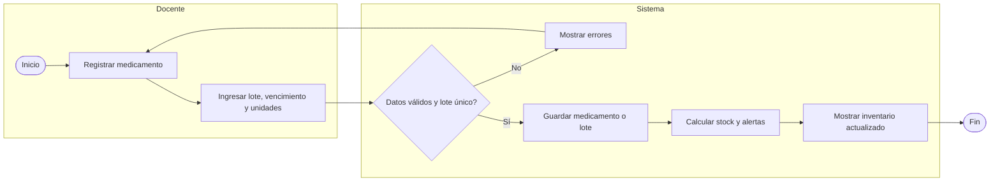
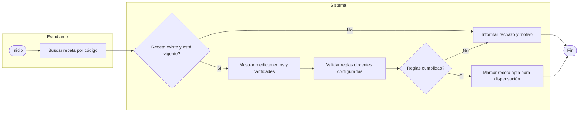
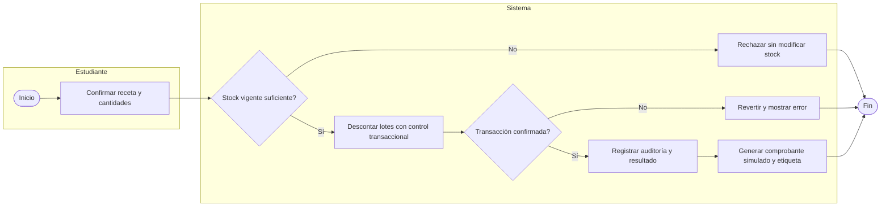
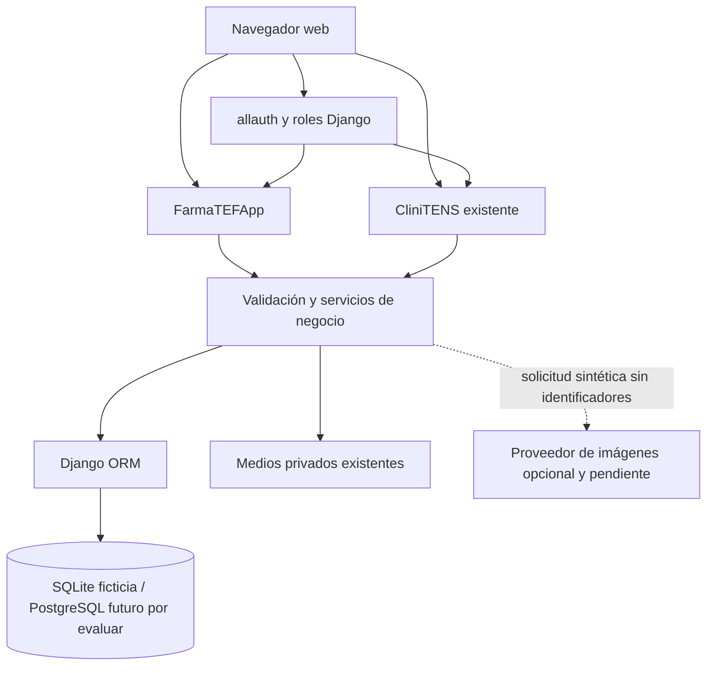
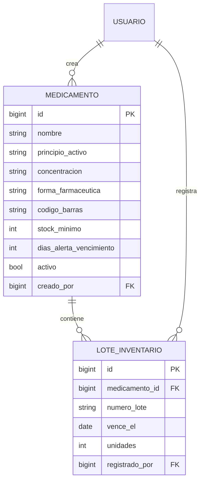

# Preinforme Informe 2 FarmaTEF CliniTENS

**Evaluación Formativa 2 — borrador para retroalimentación docente**  
**Equipo:** Jonathan Cerda y Valentina Román  
**Área académica:** Tecnología, Información y Ciberseguridad  
**Carrera:** Ingeniería en Informática  
**Asignatura:** TIHI84 Proyecto de Título  
**Fecha de preinforme:** 4 de noviembre de 2026  
**Versión de avance:** 17 de octubre de 2026  
**Entrega del Informe ES2:** 25 de noviembre de 2026  

**Estado del documento:** avance para retroalimentación. Distingue lo observado, lo propuesto y lo implementado; no acredita aceptación docente, pruebas del nuevo módulo ni despliegue.

## I Introducción

Este preinforme presenta el avance de diseño y desarrollo de FarmaTEF-CliniTENS, una plataforma educativa para apoyar la práctica simulada de Técnico en Farmacia y complementar la experiencia digital de Técnico en Enfermería. El Informe 1 describió una brecha distinta entre ambas áreas: en Farmacia, el inventario, la revisión de recetas y la dispensación se trabajan de forma manual o verbal y no se conserva el stock entre periodos; en TENS ya existen una ficha clínica electrónica y una sala de simulación de alta fidelidad en INACAP Sede Chillán (Cerda & Román, 2026). Por ello, la solución busca complementar los recursos disponibles y atender primero el flujo que presenta mayor necesidad de apoyo digital.

El levantamiento del Informe 1 combinó una entrevista semiestructurada a la directora de Sede con una encuesta digital exploratoria. Al 18 de septiembre de 2026 se habían reunido 44 respuestas: 33 de estudiantes de TENS, 9 de estudiantes de Técnico en Farmacia y 2 docentes, uno por carrera. La cantidad de respuestas de Farmacia representa una primera aproximación frente a un universo informado de 77 estudiantes; no es una muestra estadísticamente representativa. Estos antecedentes orientan el diseño, pero las reglas de operación y los criterios de aceptación todavía deben revisarse con las personas usuarias responsables (Cerda & Román, 2026).

La solución propuesta reutiliza la aplicación Django existente de CliniTENS y agrega gradualmente el flujo de Farmacia. El alcance del MVP descrito en el Informe 1 comprende inventario por medicamentos y lotes, validación de recetas ficticias, descuento de existencias al dispensar, comprobante simulado y etiquetas imprimibles. Como complemento, TENS contempla casos estructurados y material visual generado o asistido por IA, siempre bajo revisión y aprobación docente antes de publicarse. En esta etapa la generación mediante IA no está integrada.

El repositorio ya tiene el núcleo de CliniTENS y comenzó un incremento de FarmaTEF para gestionar medicamentos y lotes. Ese incremento aún no se ha validado porque el intérprete Python configurado no inicia en este equipo. Por tanto, los diagramas, metas de servicio y resultados de pruebas incluidos aquí describen propuestas o trabajo pendiente, salvo que se identifiquen expresamente como implementados.

La guía de Unidad 2 solicita comparación de tecnologías y factibilidad, descripción de componentes, arquitectura, BPMN/UML, modelo de datos, KPI/SLA, aseguramiento de calidad y planificación. Este avance busca recibir retroalimentación antes de completar el Informe ES2. El preinforme se revisa el 4 de noviembre; la retroalimentación está calendarizada para los días 11 y 18 de noviembre, y el Informe ES2 se entrega el 25 de noviembre de 2026. EVS3, con presentación del informe y demostración del prototipo, está programada para el 2 y 9 de diciembre; EVS4, correspondiente a la defensa, para el 16 y 23 de diciembre. La captura del calendario indica ponderaciones de 25% para ES2, 25% para EVS3 y 35% para EVS4, y señala una nota mínima superior a 4,0 como prerrequisito de defensa. Estas fechas y condiciones se presentan como información del calendario del curso, no como requisitos funcionales del producto.

## II Detalle de las tecnologías a implementar

### 2.1 Análisis comparativo preliminar y factibilidad

La selección prioriza la reutilización de CliniTENS, la capacidad de implementar transacciones seguras y el costo acotado del prototipo. La puntuación de 1 a 5 es una evaluación preliminar del equipo: 1 representa baja adecuación y 5 alta adecuación. No es una medición de rendimiento ni una cotización comercial.

| Alternativa | Integración con CliniTENS 30% | Velocidad para el equipo 25% | Costo de prototipo 20% | Operación futura 15% | Seguridad de datos 10% | Puntaje ponderado / 5 |
|---|---:|---:|---:|---:|---:|---:|
| Django existente con templates y ORM | 5 | 5 | 5 | 4 | 4 | 4,75 |
| API separada y frontend SPA nuevo | 2 | 2 | 3 | 4 | 3 | 2,55 |
| Sistema nuevo en framework distinto | 1 | 1 | 2 | 3 | 2 | 1,65 |

La opción recomendada para el prototipo es extender Django, porque el inicio de sesión, los roles, cursos, plantillas y estilo compartido ya existen. Un servicio separado agregaría autenticación, despliegue y sincronización que el equipo tendría que construir dentro de un plazo reducido. La comparación debe revisarse con el docente, especialmente si la pauta exige una matriz cuantitativa sustentada en cotizaciones o pruebas.

| Componente | Alternativa para prototipo | Alternativa para mayor concurrencia | Decisión preliminar |
|---|---|---|---|
| Base relacional | SQLite | PostgreSQL | SQLite se conserva en desarrollo local. PostgreSQL se evaluará si el prototipo requiere usuarios concurrentes o alojamiento institucional. No se migrarán datos reales en esta etapa. |
| Interfaz | Templates de Django + Tailwind | SPA independiente | Reutilizar los templates y Tailwind ya configurados. La SPA no aporta valor suficiente para el flujo transaccional inicial. |
| Generación visual | Flujo desconectado/simulado para pruebas; API externa solo tras evaluación | Proveedor institucional aprobado | No hay proveedor ni financiamiento confirmado. No se enviarán datos identificables ni casos reales a un proveedor. |
| Documentos | PDF/impresión simulados desde el servidor | Servicio institucional de documentos | Mantener generación local para el prototipo; definir herramienta exacta y evidencia antes de afirmar el formato implementado. |

**Factibilidad técnica:** favorable para una primera versión incremental, dado que el proyecto ya utiliza Django 5.2.18 LTS, Python 3.12, SQLite, Tailwind 4.3.3, autenticación allauth y autorización centralizada. La aplicación FarmaTEF se ha iniciado en el repositorio con modelos para medicamentos y lotes; no se ha comprobado todavía su instalación, migración ni recorrido en navegador. El intérprete del entorno aislado indicado por la documentación apunta a una ruta que no existe en este equipo, por lo que se debe reparar el entorno y cotejar la migración antes de informar resultados de validación.

**Factibilidad económica:** el desarrollo se realiza con herramientas abiertas existentes. El costo de hosting, dominio, correo y proveedor de IA no está cotizado ni financiado; por tanto, se registra como costo pendiente y no como costo cero. El prototipo puede demostrar inventario sin una API de IA.

**Factibilidad de implementación:** el Informe 1 estimó 560 horas para 14 semanas de trabajo. El calendario disponible hasta ES2 es menor que el periodo originalmente planificado, por lo que se requiere priorizar y confirmar el recorrido funcional esperado. No se calcula una disponibilidad exacta de horas porque el informe no permite confirmar cuántas horas semanales puede dedicar cada integrante durante este tramo.

### 2.2 Herramientas, aplicaciones, lenguajes y componentes

| Elemento | Uso actual o propuesto | Estado |
|---|---|---|
| Python 3.12 / Django 5.2.18 LTS | Lógica, vistas, validación y persistencia | Base existente; runtime local a reparar/cotejar |
| SQLite | Base relacional del prototipo local y entorno ficticio | Configurada; no se aplicó FarmaTEFApp.0001 |
| Django Templates / HTML / Tailwind CSS 4.3.3 | Interfaz adaptable | Base existente; pantallas iniciales de inventario agregadas sin revisión visual |
| Django ORM / migraciones | Relaciones entre medicamentos, lotes, usuarios y, posteriormente, recetas/dispensaciones | Modelos iniciales y migración manual pendientes de cotejo automático |
| allauth, Axes y core.permissions | Inicio de sesión, protección de acceso y permisos | Componentes existentes; permisos Farmacia reutilizan el mixin docente y filtro por creador |
| Navegador web de equipo | Uso en laboratorio, sala de clases o demostración | Navegadores/infraestructura institucional no inventariados |
| PDF, impresora y lector de código de barras | Comprobante, etiqueta y simulación de escaneo | Requisitos propuestos; modelos de impresora/lector y compatibilidad aún no seleccionados |
| Proveedor de IA visual | Imagen sintética desde especificación docente | Pendiente de evaluación de privacidad, costo, contrato y límites; no integrado |

El hardware institucional disponible, el servidor de alojamiento, la red, la impresora y los lectores no fueron inspeccionados. Se requiere confirmarlos antes de fijar requisitos de infraestructura o SLA.

## III Detalle de la arquitectura a implementar

### 3.1 Procesos principales

Los siguientes flujos son propuestas BPMN simplificadas para revisión. Las compuertas representan decisiones; deberán diagramarse con notación BPMN 2.0 en la versión final y validarse con la docente de Farmacia.

**Proceso A — Mantener inventario (subprocesos: registrar medicamento, registrar lote, consultar stock y revisar alertas)**

**Proceso B — Revisar y validar receta ficticia (subprocesos: localizar receta, validar vigencia, comprobar reglas y comunicar resultado)**

**Proceso C — Dispensar y registrar resultado (subprocesos: confirmar cantidades, seleccionar lotes, actualizar existencias, registrar operación y emitir comprobante simulado)**

### 3.2 Casos de uso

| Actor | Caso de uso | Estado |
|---|---|---|
| Docente MANAGER | Crear medicamentos y lotes de su inventario; consultar alertas | Primer incremento iniciado, sin validar |
| ADMIN/superusuario activo | Consultar inventarios globales y administrar catálogo | Reutiliza política central de CliniTENS; vista FarmaTEF pendiente de validación |
| Estudiante RESTRICTED | Buscar receta, completar dispensación y consultar su resultado | Propuesto; no implementado |
| Docente | Crear receta y reglas, revisar transacciones/resultados | Propuesto; reglas de negocio pendientes de confirmación |
| Docente TENS | Preparar especificación de caso, revisar y aprobar material visual | Flujo actual de CliniTENS no incluye generación IA; integración pendiente |

### 3.3 Componentes lógicos

La API de IA es una dependencia futura y no forma parte de la ruta crítica de dispensación. Las claves, si se aprueba un proveedor, permanecerán en configuración de servidor y nunca en el navegador.

### 3.4 Modelo lógico inicial y diccionario

El modelo Farmacia agregado en el primer incremento es más pequeño que el modelo final. Los campos de recetas, transacciones y actividad deben definirse con la docente antes de su migración.

| Entidad/campo | Tipo lógico | Regla propuesta/implementada | Clasificación |
|---|---|---|---|
| Medicamento.nombre | Texto, hasta 160 | Requerido; único por creador | Implementado en modelo; validación pendiente |
| Medicamento.codigo_barras | Texto, hasta 64 | Opcional; único por creador cuando se informa | Implementado en modelo; validación pendiente |
| Medicamento.stock_minimo | Entero no negativo | Umbral docente para alerta de reposición | Implementado; política por curso pendiente |
| Medicamento.dias_alerta_vencimiento | Entero 1–365, default 90 | Umbral configurable para alerta | Implementado; validar valor con docente |
| LoteInventario.numero_lote | Texto, hasta 80 | Único dentro del medicamento | Implementado en modelo; validación pendiente |
| LoteInventario.vence_el | Fecha | Obligatoria; conserva lotes vencidos para alertar | Implementado; validación pendiente |
| LoteInventario.unidades | Entero positivo | Cantidad por lote | Implementado; no incluye movimiento transaccional aún |
| creado_por / registrado_por | FK a Usuario | Autoría y filtros de propiedad | Implementado en modelo; permisos sin verificar |
| Receta, detalle y dispensación | Por definir | Incluir identidad sintética, estado, cantidades y resultado transaccional | Pendiente de diseño docente |

### 3.5 Topología de comunicaciones

Para el prototipo se propone un navegador que accede al servidor Django mediante HTTP local o HTTPS si existe un entorno compartido. Django aplica sesión, CSRF, autorización y validación del lado servidor; el ORM accede a base relacional. Los medios permanecen detrás del mecanismo privado de CliniTENS. Una eventual integración IA usaría una conexión saliente TLS desde el servidor, con datos sintéticos y credenciales privadas.

El desarrollo local conocido no acredita una topología institucional. Certificados TLS, proxy, firewall, dirección, proveedor, DNS y ancho de banda deben confirmarse con TI antes de describirlos como implementados.

### 3.6 Infraestructura

| Ambiente | Componentes | Uso | Estado |
|---|---|---|---|
| Desarrollo local | Windows, Python/Django, SQLite, navegador | Construcción y demostración con fixtures | Existente; intérprete apuntado desde el target falló |
| Validación aislada | `core.test_settings`, SQLite en memoria y media temporal | Verificación sin tocar base/media recibidos | Configurado en repo; requiere entorno Python funcional |
| Alojamiento compartido | Servidor de aplicación, PostgreSQL, proxy TLS, respaldo y almacenamiento privado | Pilotaje institucional eventual | Propuesto; proveedor y topología sin confirmar |
| Servicio IA externo | API HTTPS, credencial de servidor y revisión humana | Crear propuesta visual ficticia | Alternativa pendiente; no hay API integrada |

### 3.7 Arquitectura de solución

Se mantiene una arquitectura web monolítica modular con renderizado en servidor. La decisión reduce duplicación de identidad y permite reutilizar permisos y layouts. El navegador no determina autorizaciones. El backend valida rol, propiedad, curso y estado de cada operación. La base inicial del prototipo es SQLite; una migración a PostgreSQL requiere plan separado, copia, prueba de compatibilidad y aprobación.

## IV Implementación de KPI y SLA

Los valores de esta sección son metas preliminares, no mediciones ni compromisos de servicio vigentes.

### 4.1 KPI SMART propuestos

| KPI | Cálculo | Meta preliminar | Medición y plazo |
|---|---|---|---|
| Exactitud de stock después de dispensación | Operaciones ejecutadas con existencias correctas / operaciones ejecutadas × 100 | 100% en el conjunto de casos acordado | Medir al completar pruebas de integración antes de EVS3; adjuntar casos y resultados |
| Duración del flujo de dispensación | Percentil 95 del tiempo desde confirmar una receta apta hasta mostrar el comprobante | ≤2 s, meta heredada como propuesta del Informe 1 | Medir 30 ejecuciones sintéticas en un equipo y ambiente identificados antes de EVS3; reportar resultados reales aunque la meta no se alcance |
| Rechazos correctos por falta de stock | Intentos insuficientes rechazados sin cambio de existencias / intentos con falta de stock × 100 | 100% en el conjunto de casos de prueba | Medir durante la integración del flujo y registrar evidencia antes de EVS3 |
| Aprobación docente de contenido IA | Material publicado con aprobación registrada / material IA publicado × 100 | 100%; no publicar si falta aprobación | Solo aplica si el flujo IA se implementa; no hay integración actualmente |
| Tiempo de preparación de inventario | Tiempo empleado para registrar un conjunto acordado de medicamentos y lotes | Establecer línea base y luego una meta con docente | Medir una vez antes de EVS3; no comparar hasta acordar procedimiento y muestra |

### 4.2 SLA de prototipo propuestos

No existe un proveedor de hosting ni un cliente institucional que haya aprobado SLA. Se proponen estos objetivos para una sesión programada de demostración:

| Servicio | Resultado para el usuario | Ventana | Meta propuesta | Exclusiones y recuperación |
|---|---|---|---|---|
| Acceso a FarmaTEF | Docente prepara inventario y estudiante ejecuta práctica | Sesiones coordinadas con docente | ≥99,5% de disponibilidad durante una ventana, medido por monitoreo manual | Excluir conectividad institucional/equipo y mantenimiento informado; conservar copia de base ficticia y reanudar desde respaldo |
| Consulta/dispensación | Respuesta de acciones críticas | Durante demo | P95 ≤2 segundos con carga y equipo descritos | No representa SLA de producción; registrar latencia y errores |
| Generación visual opcional | Propuesta disponible para revisión docente | Proceso asincrónico | ≤5 minutos como meta heredada del Informe 1 | Sujeto a disponibilidad/límites del proveedor; sin publicar automáticamente |

**Autorización pendiente:** gestor de servicio, cliente, lugar/fecha, criticidad, activos, ventanas de mantenimiento, medición, metas de capacidad y tiempo de recuperación deben confirmarse antes de llamar a esto un SLA acordado.

| Campo de control del SLA | Definición para completar con las personas responsables |
|---|---|
| Servicio y responsable de servicio | Prototipo de FarmaTEF; responsable técnico y responsable funcional por designar |
| Cliente/usuarios y autorización | Equipo docente y participantes de la demostración; autorización formal pendiente |
| Fecha y lugar de vigencia | Por acordar con el equipo responsable; no existe servicio institucional en producción |
| Proceso de negocio y resultado esperado | Práctica simulada de inventario, validación de receta y dispensación con datos ficticios |
| Activos críticos | Aplicación, base ficticia, equipo y red del entorno de demostración; respaldo de recuperación |
| Horario de servicio y mantenimiento | Sesiones programadas; calendario y aviso de mantenimiento por acordar |
| Capacidad, disponibilidad y respuesta | Metas preliminares de la tabla anterior; deben medirse en el entorno definido |
| Continuidad y recuperación | Restauración de copia ficticia; tiempo objetivo de recuperación aún por definir y ensayar |

## V Plan de pruebas y aseguramiento de calidad

### 5.1 Plan preliminar de pruebas

| Tipo | Casos principales | Evidencia prevista | Estado |
|---|---|---|---|
| Humo (smoke) | Iniciar aplicación, autenticar, abrir inventario y consultar pantalla principal | Registro breve del recorrido mínimo | Pendiente |
| Unitarias | Validación de cantidades, vencimiento, umbral y estado de receta | Salida automatizada por regla | Pendiente para FarmaTEF |
| Integración | Inventario→receta→dispensación; atomicidad; lote vencido/no disponible | Transacción completa con base ficticia | Pendiente |
| Autorización | URL directa anónimo/estudiante/MANAGER dueño/MANAGER ajeno/ADMIN | Código HTTP y ausencia de cambios ajenos | Pendiente para FarmaTEF |
| Migración | Aplicar y revertir `FarmaTEFApp.0001_initial` en una base ficticia | Plan, esquema y conteos antes/después | Pendiente; la migración manual no se cotejó |
| Usabilidad | Docente registra medicamento/lote; estudiante completa recorrido acordado | Observación, tareas completadas y tiempos | Pendiente |
| Alfa | Recorrido funcional completo por el equipo en ambiente controlado, antes de invitar participantes | Lista de criterios, defectos y correcciones | Pendiente |
| Beta | Uso supervisado con participantes y datos sintéticos, solo después de aprobar la prueba alfa | Observaciones de uso, incidencias y conformidad docente | Pendiente; participantes y autorización por definir |
| Rendimiento/estrés | P95 de consulta/dispensación y respuesta al aumentar la carga acordada | Herramienta, carga, ambiente y resultados | Pendiente; no se ha ejecutado prueba de estrés |
| Recuperación | Restaurar copia sintética; simular falla de guardado | Registro de recuperación sin corrupción | Pendiente |
| IA y revisión humana | Rechazo, regeneración, trazabilidad y bloqueo de publicación | Registro de prompts sintéticos y aprobador | Pendiente; no existe proveedor integrado |

El historial del repositorio registra 47 pruebas Django y 4 JavaScript correctas para la línea base de 004. Esos resultados no cubren el cambio de FarmaTEF. En este incremento no se ha ejecutado la suite ni `manage.py check`. El ejecutable configurado intentó cargar Python desde una ruta inexistente; debe repararse el entorno antes de presentar resultados de validación.

### 5.2 Normas y estándares considerados

| Referencia | Aplicación acotada | Límite |
|---|---|---|
| BPMN 2.0 | Modelar inventario, validación de receta y dispensación | Los flujos de este borrador son simplificados; la versión final debe usar elementos BPMN identificables y ser revisada con las personas responsables |
| UML 2.5 | Representar casos de uso y componentes; complementar el modelo de datos | Los diagramas de casos de uso y componentes deben agregarse formalmente a la versión final; la tabla de actores no los sustituye |
| OWASP Top 10:2025 y ASVS 5.0 | Guía para controles web, validación y acceso por objeto | Revisión selectiva, no certificación ni pentest completo |
| COBIT 2019 | Gobierno liviano: riesgo de contenido IA, proveedor y beneficios | Aplicar solo objetivos ya seleccionados en el Informe 1 |
| ITIL 4 | Disponibilidad, continuidad, incidentes y niveles de servicio | Adaptación de proyecto académico; no operación TIIL completa |
| APA 7 | Citas, referencias, tablas y figuras | Seguir además la guía bibliográfica indicada por INACAP |
| Ley 21.719 | Minimización, seguridad y derechos sobre datos personales | La BCN indica entrada en vigor el 1 de diciembre de 2026; el responsable institucional debe confirmar obligaciones aplicables al piloto |

## VI Plan de implementación

### 6.1 Disponibilidad

Durante la demostración se propone iniciar el servidor antes de la sesión, usar una base ficticia preconfigurada, confirmar acceso de red y tener un recorrido sin dependencia de IA. La disponibilidad no se declarará para un entorno productivo mientras no se elijan hosting, monitoreo y responsables.

### 6.2 Continuidad

Medidas propuestas para el prototipo: exportar una copia de la base ficticia antes de cada demostración; mantener una versión de código conocida; guardar instrucciones para recrear fixtures; registrar fallas que impidan una transacción; y reanudar desde una copia, nunca reparando manualmente la base durante una dispensación incompleta. El procedimiento no se ha ensayado en un destino productivo.

### 6.3 Mantención

- **Configuración:** versionar código, dependencias y migraciones; no incluir `.env`, base local, media ni claves.
- **Cambios:** registrar solicitud, requisito, impacto, revisión por un integrante y evidencia antes de integrar.
- **Incidentes:** registrar fecha, ambiente, síntoma, efecto, datos sintéticos involucrados, solución y verificación.
- **Respaldo:** conservar copia previa al ensayo de migraciones; restaurar solo en entorno ficticio durante desarrollo.
- **IA:** revisar proveedor, condiciones de datos, costos, retención y contenido antes de activar credenciales; toda publicación necesita validación docente.

## VII Ajustes del cronograma

| Fecha | Hito | Resultado esperado |
|---|---|---|
| Hasta 3 nov 2026 | Preparar el preinforme | Consolidar avance, propuestas, pendientes y preguntas para revisión |
| 4 nov 2026 | EF2 — preinforme de desarrollo | Revisión formativa; presentar el rumbo y recibir observaciones |
| 11 nov 2026 | Retroalimentación y ajustes | Registrar observaciones y cambios acordados |
| 18 nov 2026 | Segunda instancia de retroalimentación y ajustes | Cerrar dudas prioritarias y evidenciar correcciones |
| 19–24 nov 2026 | Completar el Informe ES2 | Consolidar diagramas, anexos, trazabilidad, pruebas ejecutadas y referencias |
| 25 nov 2026 | ES2 — Informe de Desarrollo (25%) | Entregar la versión completa según las instrucciones de la asignatura |
| 26 nov–1 dic 2026 | Preparar presentación y prototipo | Ensayar recorrido con datos ficticios y plan de contingencia |
| 2 dic 2026 | EVS3 — primera fecha (25%) | Presentar el Informe ES2 según calendario |
| 9 dic 2026 | EVS3 — segunda fecha (25%) | Presentar el prototipo funcional según calendario |
| 10–15 dic 2026 | Preparar la defensa | Explicar problema, decisiones, construcción, evidencia y límites |
| 16 dic 2026 | EVS4 — primera fecha (35%) | Defensa del proyecto, según el orden que confirme el curso |
| 23 dic 2026 | EVS4 — segunda fecha (35%) | Defensa del proyecto, según el orden que confirme el curso |

El calendario del curso identifica ES2 como evaluación sumativa de 25%, EVS3 como evaluación sumativa de 25% y EVS4 como evaluación sumativa de 35%. También indica que para presentarse a la defensa se requiere una nota superior a 4,0 y que el orden de grupos está por confirmar. Se solicita al docente confirmar qué recorrido funcional es suficiente para EVS3 y qué módulos del MVP se consideran obligatorios; el ajuste de prioridad se debe acordar y registrar.

## VIII Conclusiones preliminares

El Informe 1 justificó una plataforma integrada, pero la diferencia entre la estimación de 560 horas y el calendario cercano exige priorizar la evidencia que se presentará en cada evaluación. La reutilización de Django y de CliniTENS reduce trabajo de autenticación y presentación. FarmaTEF comenzó con el modelo de inventario docente, aunque este avance aún necesita cotejo de migración y validación aislada antes de considerarse operativo.

Para EVS3, el recorrido central propuesto es demostrar que el sistema puede mantener inventario ficticio y completar una dispensación segura que actualice stock y deje evidencia. La integración real de IA debe quedar subordinada a privacidad, financiamiento y aprobación docente. Si no se valida a tiempo, se describirá como pendiente y no como función implementada.

La retroalimentación que se solicita al docente es: confirmar el recorrido que debe quedar funcional para EVS3; validar los procesos BPMN y reglas de farmacia; confirmar KPI/SLA razonables para el prototipo; precisar anexos y rúbrica; y orientar el tratamiento de la brecha de horas.

## IX Referencias preliminares

Biblioteca del Congreso Nacional de Chile. (2024). *Ley N.º 21.719, regula la protección y el tratamiento de los datos personales y crea la Agencia de Protección de Datos Personales*. https://www.bcn.cl/leychile/navegar?idNorma=1209272

Django Software Foundation. (2025). *Django 5.2 release notes*. https://docs.djangoproject.com/en/5.2/releases/5.2/

INACAP. (s. f.). *Citas y referencias bibliográficas*. https://portal.inacap.cl/es/biblioteca/apoyo-academico/citas-y-referencias

Cerda, J., & Román, V. (2026). *Informe 1 Proyecto de Título FarmaTEF-CliniTENS* [Informe académico no publicado]. INACAP Sede Chillán.

OWASP Foundation. (2025). *OWASP Top 10:2025*. https://top10.owasp.org/2025/

OWASP Foundation. (2025). *Application Security Verification Standard 5.0.0*. https://github.com/OWASP/ASVS/tree/v5.0.0

Organización Mundial de la Salud. (2023, 16 de mayo). *La OMS propugna un uso seguro y ético de la inteligencia artificial para la salud*. https://www.who.int/es/news/item/16-05-2023-who-calls-for-safe-and-ethical-ai-for-health

El Informe 1 contiene además la bibliografía de simulación, FarmaTEF, COBIT y levantamiento de requisitos. Se conservará y completará en la entrega final después de cotejar cada fuente y mantener citas solo donde respalden afirmaciones del informe.

## X Anexos previstos

1. Matriz que vincule los criterios EA3/EA4, sección del informe, requisito y evidencia.
2. BPMN formal de inventario, validación de receta y dispensación.
3. Diagrama UML de casos de uso, componentes y modelo lógico ampliado.
4. Diccionario de datos de inventario, recetas, dispensaciones y auditoría.
5. Matriz de comparación tecnológica y factibilidad con criterios acordados.
6. Plan de pruebas con escenarios, datos ficticios, responsable y resultado.
7. Capturas del prototipo de FarmaTEF después de validar el recorrido; ninguna captura de este borrador demuestra ejecución funcional.
8. Evidencia actualizada del levantamiento primario del Informe 1, respetando su carácter exploratorio.
9. Matriz de trazabilidad entre los requisitos funcionales RF-01 a RF-19 y los requisitos no funcionales del Informe 1, las tareas de diseño/desarrollo, las pruebas previstas y la evidencia que se genere. La matriz final marcará el estado observado, propuesto, implementado o verificado, sin usar estos términos como equivalentes.

### Matriz preliminar de trazabilidad de requisitos

La siguiente matriz resume la relación entre los requisitos priorizados en el Informe 1, los módulos o tareas del Informe 2 y la evidencia que deberá reunirse. La indicación de estado describe el proyecto al momento de este borrador; “iniciado” no significa probado ni aceptado.

| Requisito del Informe 1 | Necesidad o módulo asociado | Estado observado en el proyecto | Trabajo y evidencia pendiente |
|---|---|---|---|
| RF-01 búsqueda de fármacos | Catálogo y consulta | Catálogo inicial; flujo de búsqueda debe verificarse | Pruebas por nombre, principio activo, presentación y sin resultados |
| RF-02 escaneo simulado | Identificación por código | Código de barras existe como dato del modelo; escaneo no verificado | Caso válido y código desconocido; capturas y resultados |
| RF-03 clasificación de receta | Validación farmacéutica | Pendiente | Definir reglas con docente; probar completa, incompleta y revisión profesional |
| RF-04 stock, lotes y vencimientos | Inventario y alertas | Primer incremento implementado; no verificado | Probar umbral, lotes, vencimiento y persistencia |
| RF-05 descuento de stock | Dispensación | Pendiente | Prueba de transacción, stock insuficiente y ausencia de descuento parcial |
| RF-06 perfiles de interacción | Paciente/cliente simulado | Pendiente | Acordar perfiles y probar consistencia del escenario |
| RF-07 diseño e impresión de etiquetas | Salida simulada | Pendiente | Definir campos obligatorios y validar impresión/exportación |
| RF-08 explicación del error | Retroalimentación | Pendiente | Verificar orden de explicación y respuesta correcta |
| RF-09 segundo intento | Retroalimentación | Pendiente | Probar segundo intento y resultado posterior |
| RF-10 contexto de caso clínico | Casos TENS | Funcionalidad existente de CliniTENS; alcance exacto por verificar | Relacionar escenario de prueba y criterio de aceptación |
| RF-11 especificación estructurada de caso | Autoría docente | Pendiente de contraste con el alcance implementado | Verificar campos obligatorios y rechazo de especificación incompleta |
| RF-12 apoyo visual generado y aprobado | Flujo IA para casos TENS | No implementado | Si se integra: verificar generación, aprobación obligatoria, rechazo y regeneración |
| RF-13 caso interactivo paso a paso | Interacción TENS | Debe cotejarse con el módulo actual; no se afirma cobertura | Verificar secuencia, bloqueo de avance y persistencia del paso |
| RF-14 registro de hallazgos y decisiones | Historial de caso TENS | Debe cotejarse con el módulo actual; no se afirma cobertura | Probar asociación hallazgo-decisión e historial consultable |
| RF-15 detección de errores | Evaluación de caso TENS | Pendiente de cotejo | Acordar reglas y probar registros incompletos y decisiones no pertinentes |
| RF-16 revisión docente de errores y retroalimentación | Resultados TENS | Debe cotejarse con las capacidades actuales; no se afirma cobertura completa | Probar listado, retroalimentación y exportación como evidencia |
| RF-17 autenticación y roles | Acceso transversal | Infraestructura existente; permisos específicos FarmaTEF no validados | Probar acceso directo por rol y propiedad |
| RF-18 panel y exportación | Resultados para docente | Capacidades existentes descritas en CliniTENS; correspondencia con RF debe cotejarse | Verificar comparación, filtros y exportación exigida |
| RF-19 activar/desactivar actividad y respaldo | Control de actividad | Pendiente de cotejo específico contra el requisito | Probar bloqueo, respaldo y reactivación sin pérdida |
| RNF-01 privacidad y datos sintéticos | Todos los módulos | Regla documentada; revisión de datos del prototipo pendiente | Revisar fixtures y evidencias sin usar datos personales reales |
| RNF-02 disponibilidad ≥99,5% | Sesiones programadas | Meta propuesta; no medida | Definir ventana, método de medición y registrar interrupciones |
| RNF-03 P95 ≤2 s | Operaciones críticas | Meta propuesta; no medida | Medir muestra, carga, equipo y configuración |
| RNF-04 generación visual ≤5 min | Flujo IA | No aplica mientras no exista proveedor integrado | Medir solo si la integración se implementa |
| RNF-05 trazabilidad y aprobación IA | Flujo IA | No implementado en esta integración | Definir datos registrados y prueba de bloqueo sin aprobación |
| RNF-06 conectividad limitada | Uso en laboratorio | Pendiente de validación | Acordar comportamiento esperado ante desconexión; ejecutar prueba |
| RNF-07 confidencialidad y coherencia docente | Casos TENS/Farmacia | Regla de diseño pendiente de validación por responsable | Registrar revisión y aprobación antes de publicar casos |

La matriz definitiva debe cotejar los textos y criterios completos del Informe 1 y vincular cada criterio de aceptación con una prueba y su evidencia. La presencia de una función parecida en CliniTENS no demuestra por sí sola que se cumpla el requisito.

## Puntos que requieren retroalimentación del docente

1. ¿Qué recorrido mínimo de Farmacia debe quedar demostrable en EVS3?
2. ¿Qué reglas hacen que una receta ficticia se acepte o rechace, y qué campos debe llevar la etiqueta/comprobante?
3. ¿Los KPI/SLA propuestos son evaluables en el entorno disponible y qué metas espera el cliente institucional?
4. ¿Se espera integración real con proveedor IA o basta documentar su factibilidad y gobernanza para esta entrega?
5. ¿Cómo se prioriza frente a la diferencia entre las 560 horas planificadas y las fechas de noviembre/diciembre?

## Fuentes externas cotejadas para este borrador

- Django designa la serie 5.2 como LTS y documenta compatibilidad con las versiones recientes de Python. https://docs.djangoproject.com/en/dev/releases/5.2/
- La BCN indica que la Ley 21.719 entra en vigencia el 1 de diciembre de 2026. https://www.bcn.cl/leychile/Navegar?idNorma=1209272&idParte=10527471&idVersion=2026-12-01
- Bibliotecas INACAP describe su guía como adaptación APA 7 para citas, tablas, figuras y referencias. https://portal.inacap.cl/es/biblioteca/apoyo-academico/citas-y-referencias
- La auditoría previa del repositorio cita OWASP Top 10:2025 y ASVS 5.0.0 como referencias de revisión acotada, no certificación.
